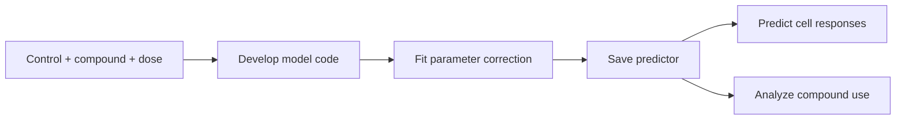

<h1 align="center">🧬 CytoWright</h1>

<h3 align="center">Agentic Model Development for Cellular Response Prediction</h3>

<p align="center">
  <b>English</b> · <a href="README.zh-CN.md">简体中文</a>
</p>


<p align="center">
  <a href="#try-it"></a>
  <a href="programs/"></a>
  <a href="docs/WORKFLOW.md"></a>
  <a href="https://github.com/limengran98/CytoWright"></a>
</p>

<p align="center">
  
  
  
  <a href="#checks"></a>
  <a href="LICENSE"></a>
</p>

<p align="center">
  <a href="#try-it">⚡ Try it</a> ·
  <a href="#how-it-works">⚙️ How it works</a> ·
  <a href="#development">🧠 Develop</a> ·
  <a href="#correction">🛠️ Correct</a> ·
  <a href="#prediction">🔬 Predict &amp; analyze</a> ·
  <a href="#checks">✅ Checks</a> ·
  <a href="#repository-map">🗂️ Code map</a>
</p>

💡 **CytoWright turns execution feedback into cellular-response predictors.** It predicts morphology and gene-expression profiles from an untreated control, compound structure and dose. A language-model agent develops executable model code; fitted readout and compound-route updates improve the trained predictor while retaining its encoders.



<a id="try-it"></a>

## ⚡ Try it: copy, paste, run

**Python 3.10+ · PyTorch · CPU.** The walkthrough creates synthetic response data, fits a correction, saves the model and reloads it for prediction.

```bash
git clone https://github.com/limengran98/CytoWright.git
cd CytoWright
python -m pip install -e .
python examples/feedback_demo.py --output outputs/demo
```

The example uses **96 training**, **48 validation** and **64 query** samples. Its default run prints:

```text
status: complete
original_mse: 1.2558
corrected_mse: 0.0380
corrected_pcc: 0.9848
native_reload_max_error: 0.0
```

📁 The generated files are ready for the prediction commands below:

```text
outputs/demo/
├── predictor.py       # model program
├── model.pt           # fitted model parameters
├── normalizer.npz     # input and response normalization
├── query.npz          # query inputs and targets
├── predictions.npy    # predicted response profiles
└── summary.json       # prediction and compound-use measurements
```

Run the same walkthrough through the installed command:

```bash
cytowright demo --output outputs/demo
```

<a id="how-it-works"></a>

## ⚙️ How it works

| Step | What CytoWright does |
| :--- | :--- |
| 🧭 **Define the task** | Fix the control, compound, dose, response features and data subsets. |
| 🧠 **Develop the program** | Propose executable models, train candidates and use their scores and errors to choose the next edit. |
| 🛠️ **Fit a correction** | Update an available readout and fit a rank-32 compound route to the remaining response error. |
| 💾 **Save the predictor** | Store the selected parameters together with the normalization statistics used for inference. |
| 🔬 **Inspect input use** | Measure prediction changes and error changes after matched compound replacement. |

```math
\widehat y
= f_s(c,p,a;\theta_0+\Delta\theta)+W\phi(p,c).
```

Here `c` is the control profile, `p` the compound representation and `a` dose. The source program `s` defines the predictor. The readout update `Δθ` and the control-modulated compound features `φ(p,c)` fit the response left unexplained by the trained model. Validation selects the resulting predictor.

📘 [Complete workflow](docs/WORKFLOW.md) · [Data and array formats](docs/DATA.md) · [Predictor programs](programs/README.md)

<a id="development"></a>

## 🧠 Develop a cellular-response model

### Prepare the data

Place the measurement tables in the [dataset layout](docs/DATA.md), then prepare the two tasks:

```bash
cytowright prepare-data --task bbbc036
cytowright prepare-data --task bbbc047
```

Each command creates named arrays under `data/arrays/<task>/`:

| File | Purpose |
| :--- | :--- |
| `training.npz` | Fit model parameters and correction features. |
| `validation.npz` | Select candidate models and correction settings. |
| `main_test.npz` | Evaluate the selected predictor. |
| `additional_test.npz` | Evaluate another group of chemical families. |

### Run model development

Configure the model service:

```bash
export CYTOWRIGHT_LLM_BASE_URL='https://your-server.example/v1'
export CYTOWRIGHT_LLM_API_KEY='your-api-key'

cytowright discover \
  --task bbbc036 \
  --output runs/bbbc036/search \
  --device cuda:0
```

The default backend is **DeepSeek-V4.1-Flash-1017**. A search evaluates ten candidate slots, including the initial model, using scores, execution feedback and a modeling agenda. The `--model` option selects another model served by the configured endpoint.

Repeated searches use the same interface:

```bash
cytowright campaign \
  --task bbbc036 \
  --searches 10 \
  --output runs/bbbc036/searches \
  --device cuda:0
```

### Fit a reference program

The [programs](programs/) directory supplies directly trainable architectures:

| Task | Control features | Response features | Program |
| :--- | ---: | ---: | :--- |
| BBBC036 | 591 | 1,568 | [Gated response predictor](programs/bbbc036/predictor.py) |
| BBBC047 | 701 | 1,678 | [Compound-query attention predictor](programs/bbbc047/predictor.py) |

```bash
cytowright train \
  --task bbbc036 \
  --source programs/bbbc036/predictor.py \
  --seed 41 \
  --output runs/bbbc036/base \
  --device cuda:0
```

The output contains `predictor.py`, `model.pt`, `normalizer.npz` and `metrics.json`.

<a id="correction"></a>

## 🛠️ Fit a parameter correction

```bash
cytowright correct \
  --source runs/bbbc036/base/predictor.py \
  --checkpoint runs/bbbc036/base/model.pt \
  --fit data/arrays/bbbc036/training.npz \
  --selection data/arrays/bbbc036/validation.npz \
  --seed 41 \
  --output runs/bbbc036/corrected
```

The editor fits **four readout candidates** and **four compound-route candidates**. It retains the trained encoders, constructs compound features from training residuals and uses validation PCC with the MSE criterion to select the update. The output is a saved `selected.pt` checkpoint, `normalizer.npz` and `RESULT.json`.

🧩 The same editor supports both task dimensions and predictor programs that expose the shared `build_model(task_spec)` interface.

<a id="prediction"></a>

## 🔬 Predict responses and analyze compound use

The quickstart output can be used immediately:

```bash
cytowright predict \
  --source outputs/demo/predictor.py \
  --checkpoint outputs/demo/model.pt \
  --normalizer outputs/demo/normalizer.npz \
  --data outputs/demo/query.npz \
  --output outputs/demo/predictions.npy

cytowright analyze \
  --source outputs/demo/predictor.py \
  --checkpoint outputs/demo/model.pt \
  --normalizer outputs/demo/normalizer.npz \
  --data outputs/demo/query.npz \
  --maps 32 \
  --output outputs/demo/compound_analysis.json
```

Prediction returns response profiles on the original measurement scale. Analysis reports Global PCC, MSE, morphology PCC, expression PCC, matched-sample coverage and the effect of compound replacement. Replacement holds the complete control profile and dose fixed and chooses a different observed compound.

<a id="checks"></a>

## ✅ Check the installation

```bash
python -m unittest discover -s tests -v
cytowright validate
```

The tests exercise model training, parameter correction, saved-model inference, frozen encoders, the ridge equations, matched replacements and data-array preparation.

<a id="repository-map"></a>

## 🗂️ Repository map

| Path | Contents |
| :--- | :--- |
| 🧠 [`cytowright/`](cytowright/) | Model development, fitting, parameter correction and inference. |
| 🧩 [`programs/`](programs/) | Trainable BBBC036 and BBBC047 predictors and the example program. |
| ⚡ [`examples/`](examples/) | Runnable feedback-to-predictor walkthrough. |
| ⚙️ [`configs/`](configs/) | Task definitions, training settings and model-service configuration. |
| 📘 [`docs/`](docs/) | Data formats and complete command workflow. |
| 🧪 [`tests/`](tests/) | Functional and numerical checks. |
| 📦 [`scripts/`](scripts/) | Source-package utility. |

## ⚖️ License

CytoWright is released under the [MIT License](LICENSE).
