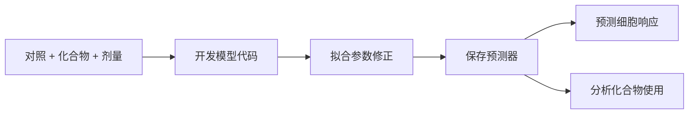

<h1 align="center">🧬 CytoWright</h1>

<h3 align="center">面向细胞响应预测的智能体模型开发</h3>

<p align="center">
  <a href="README.md">English</a> · <b>简体中文</b>
</p>

<p align="center">
  <a href="#try-it"></a>
  <a href="programs/"></a>
  <a href="docs/WORKFLOW.md"></a>
  <a href="https://github.com/limengran98/CytoWright"></a>
</p>

<p align="center">
  
  
  
  <a href="#checks"></a>
  <a href="LICENSE"></a>
</p>

<p align="center">
  <a href="#try-it">⚡ 快速上手</a> ·
  <a href="#how-it-works">⚙️ 方法流程</a> ·
  <a href="#development">🧠 开发模型</a> ·
  <a href="#correction">🛠️ 修正参数</a> ·
  <a href="#prediction">🔬 预测与分析</a> ·
  <a href="#checks">✅ 运行检查</a> ·
  <a href="#repository-map">🗂️ 代码地图</a>
</p>

💡 **CytoWright 将执行反馈转化为细胞响应预测器。** 输入未处理对照、化合物结构和剂量，预测处理后的形态与基因表达特征。语言模型智能体负责开发可执行的模型代码；参数修正保留已训练编码器，通过拟合读出层更新和化合物通路补充已有预测。



<a id="try-it"></a>

## ⚡ 快速上手：复制命令即可运行

**Python 3.10+ · PyTorch · CPU。** 示例生成合成响应数据，拟合参数修正，保存模型，再重新加载进行预测。

```bash
git clone https://github.com/limengran98/CytoWright.git
cd CytoWright
python -m pip install -e .
python examples/feedback_demo.py --output outputs/demo
```

默认示例使用 **96 个训练样本、48 个验证样本和64个查询样本**，输出为：

```text
status: complete
original_mse: 1.2558
corrected_mse: 0.0380
corrected_pcc: 0.9848
native_reload_max_error: 0.0
```

📁 生成的文件可直接用于后续预测：

```text
outputs/demo/
├── predictor.py       # 模型程序
├── model.pt           # 拟合后的模型参数
├── normalizer.npz     # 输入与响应的标准化参数
├── query.npz          # 查询输入及目标
├── predictions.npy    # 响应预测
└── summary.json       # 预测与化合物使用结果
```

也可以使用安装后的命令：

```bash
cytowright demo --output outputs/demo
```

<a id="how-it-works"></a>

## ⚙️ 方法流程

| 步骤 | CytoWright 的操作 |
| :--- | :--- |
| 🧭 **定义任务** | 固定对照、化合物、剂量、响应特征和数据用途。 |
| 🧠 **开发程序** | 提出模型、训练候选，再根据评分和执行错误选择下一次修改。 |
| 🛠️ **拟合修正** | 更新可用的读出层，利用剩余响应误差拟合秩为32的化合物通路。 |
| 💾 **保存预测器** | 保存选定参数，以及推理所需的标准化统计量。 |
| 🔬 **分析输入使用** | 在匹配条件下替换化合物，测量预测变化与误差变化。 |

```math
\widehat y
= f_s(c,p,a;\theta_0+\Delta\theta)+W\phi(p,c).
```

其中 `c` 为对照特征，`p` 为化合物表征，`a` 为剂量；程序 `s` 定义预测器。读出层更新 `Δθ` 和受对照状态调节的化合物特征 `φ(p,c)`，拟合原有预测尚未解释的响应。验证集选择最终预测器。

📘 [完整工作流](docs/WORKFLOW.md) · [数据与数组格式](docs/DATA.md) · [预测器程序](programs/README.md)

<a id="development"></a>

## 🧠 开发细胞响应模型

### 准备数据

按照[数据目录说明](docs/DATA.md)放置测量表，再准备两个任务：

```bash
cytowright prepare-data --task bbbc036
cytowright prepare-data --task bbbc047
```

每个任务在 `data/arrays/<task>/` 下生成以下数组：

| 文件 | 用途 |
| :--- | :--- |
| `training.npz` | 拟合模型参数和修正特征。 |
| `validation.npz` | 选择候选模型与修正配置。 |
| `main_test.npz` | 评价选定预测器。 |
| `additional_test.npz` | 在另一组化学家族上评价预测器。 |

### 运行模型开发

配置模型服务：

```bash
export CYTOWRIGHT_LLM_BASE_URL='https://your-server.example/v1'
export CYTOWRIGHT_LLM_API_KEY='your-api-key'

cytowright discover \
  --task bbbc036 \
  --output runs/bbbc036/search \
  --device cuda:0
```

默认后端为 **DeepSeek-V4.1-Flash-1017**。每次搜索包含十个候选名额，含初始模型；智能体结合评分、执行反馈和建模计划继续修改。通过 `--model` 可指定同一服务提供的其他模型。

重复搜索使用同一接口：

```bash
cytowright campaign \
  --task bbbc036 \
  --searches 10 \
  --output runs/bbbc036/searches \
  --device cuda:0
```

### 拟合参考程序

[programs](programs/) 提供可直接训练的模型结构：

| 任务 | 对照特征数 | 响应特征数 | 程序 |
| :--- | ---: | ---: | :--- |
| BBBC036 | 591 | 1,568 | [门控响应预测器](programs/bbbc036/predictor.py) |
| BBBC047 | 701 | 1,678 | [化合物查询注意力预测器](programs/bbbc047/predictor.py) |

```bash
cytowright train \
  --task bbbc036 \
  --source programs/bbbc036/predictor.py \
  --seed 41 \
  --output runs/bbbc036/base \
  --device cuda:0
```

输出包含 `predictor.py`、`model.pt`、`normalizer.npz` 和 `metrics.json`。

<a id="correction"></a>

## 🛠️ 拟合参数修正

```bash
cytowright correct \
  --source runs/bbbc036/base/predictor.py \
  --checkpoint runs/bbbc036/base/model.pt \
  --fit data/arrays/bbbc036/training.npz \
  --selection data/arrays/bbbc036/validation.npz \
  --seed 41 \
  --output runs/bbbc036/corrected
```

编辑器拟合 **四个读出层候选和四个化合物通路候选**。编码器保持固定，化合物特征从训练残差构建，验证集依据 PCC 和 MSE 条件选择更新。输出为 `selected.pt`、`normalizer.npz` 和 `RESULT.json`。

🧩 同一编辑器支持两个任务的维度，并通过统一的 `build_model(task_spec)` 接口适配模型程序。

<a id="prediction"></a>

## 🔬 预测响应与分析化合物使用

可以直接使用快速上手示例生成的文件：

```bash
cytowright predict \
  --source outputs/demo/predictor.py \
  --checkpoint outputs/demo/model.pt \
  --normalizer outputs/demo/normalizer.npz \
  --data outputs/demo/query.npz \
  --output outputs/demo/predictions.npy

cytowright analyze \
  --source outputs/demo/predictor.py \
  --checkpoint outputs/demo/model.pt \
  --normalizer outputs/demo/normalizer.npz \
  --data outputs/demo/query.npz \
  --maps 32 \
  --output outputs/demo/compound_analysis.json
```

预测结果使用原始测量尺度。分析结果包含全局 PCC、MSE、形态 PCC、表达 PCC、匹配样本覆盖率和化合物替换的影响。替换时固定完整对照向量与剂量，并选择另一种已观测化合物。

<a id="checks"></a>

## ✅ 检查安装与运行

```bash
python -m unittest discover -s tests -v
cytowright validate
```

测试覆盖模型训练、参数修正、保存模型的推理、编码器固定、岭回归方程、匹配替换和数据数组准备。

<a id="repository-map"></a>

## 🗂️ 代码地图

| 路径 | 内容 |
| :--- | :--- |
| 🧠 [`cytowright/`](cytowright/) | 模型开发、拟合、参数修正和推理。 |
| 🧩 [`programs/`](programs/) | 两个任务的可训练预测器和示例程序。 |
| ⚡ [`examples/`](examples/) | 可直接运行的反馈修正示例。 |
| ⚙️ [`configs/`](configs/) | 任务定义、训练设置和模型服务配置。 |
| 📘 [`docs/`](docs/) | 数据格式与完整命令流程。 |
| 🧪 [`tests/`](tests/) | 功能与数值检查。 |
| 📦 [`scripts/`](scripts/) | 源码打包工具。 |

## ⚖️ 许可证

CytoWright 使用 [MIT License](LICENSE)。
